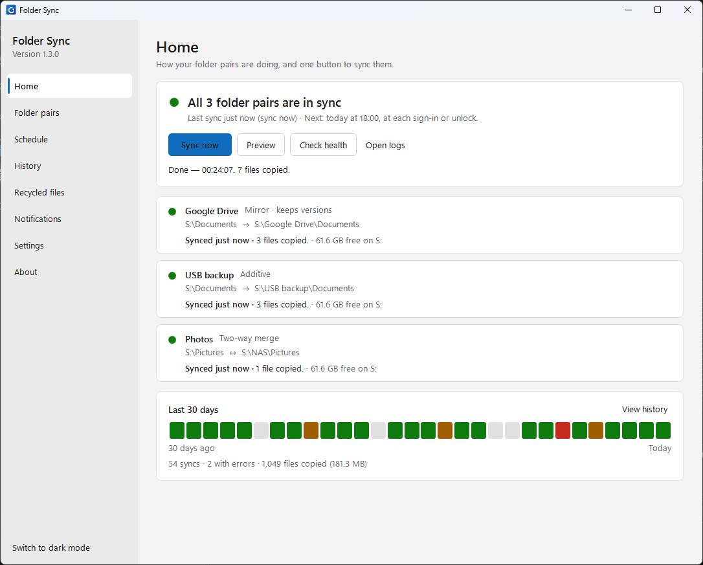
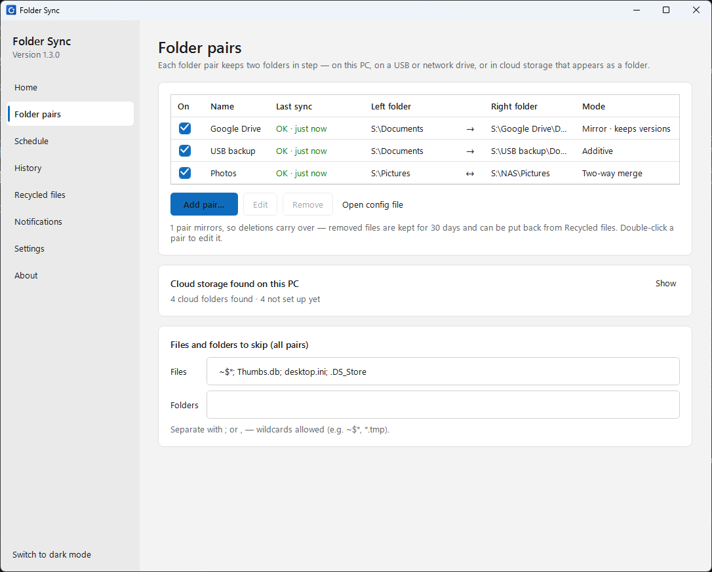
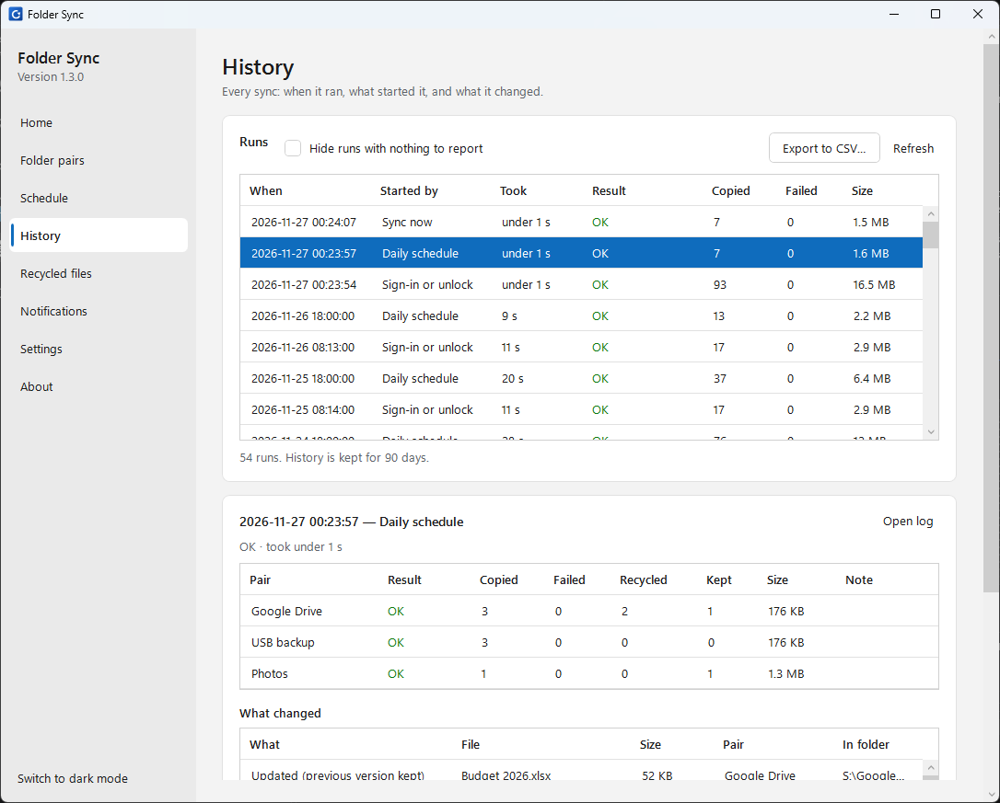
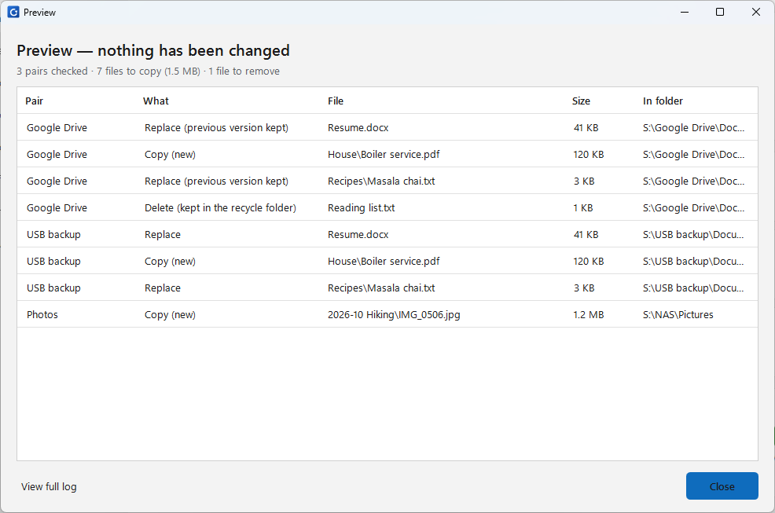
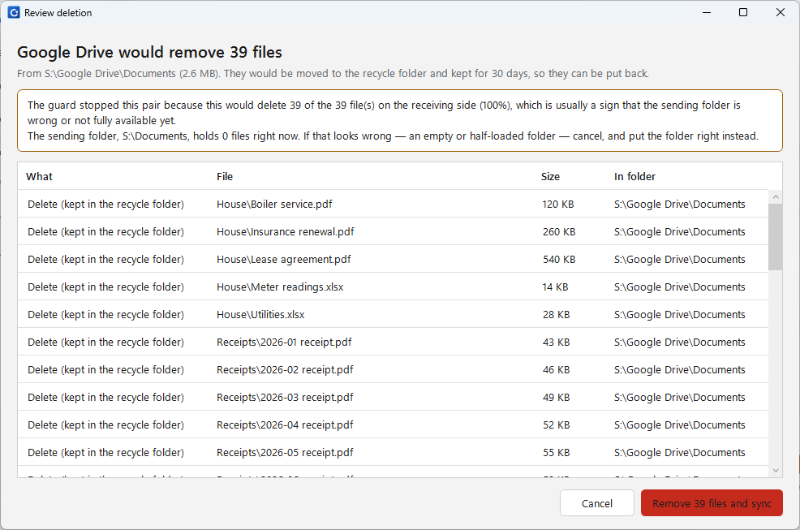
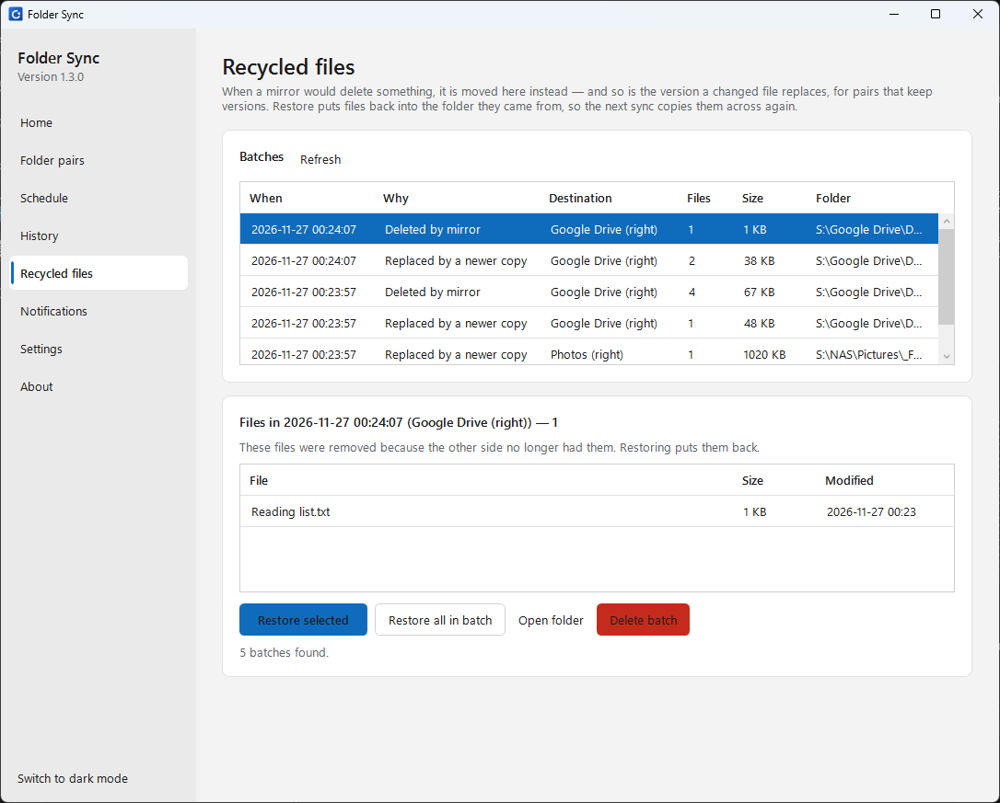
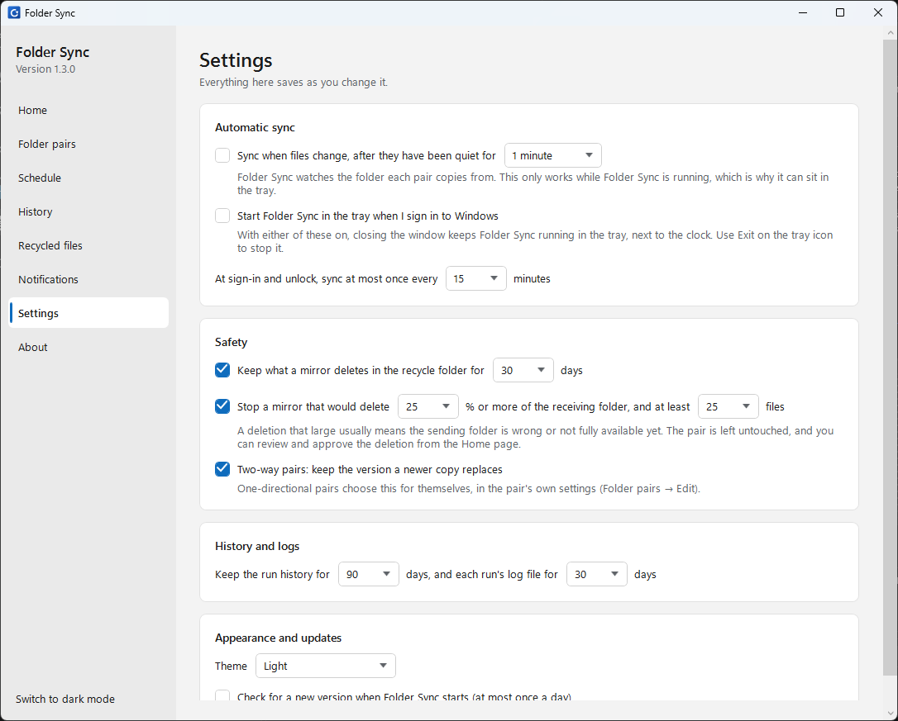
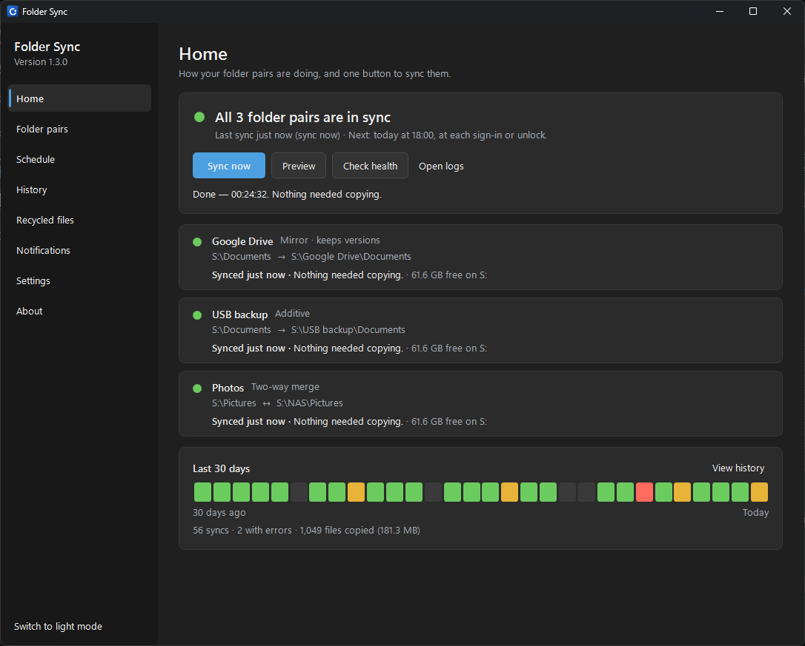

# Folder Sync

A small Windows app that mirrors one folder into **several destinations at once** — for example
your Documents folder into your **Google Drive**, **iCloud Drive** and an external backup drive,
all from a single click or on a schedule.

It works with cloud storage without any logins or API keys: OneDrive, iCloud Drive and Google
Drive for Desktop each keep a normal **local folder** on your PC that their own app syncs to the
cloud. Folder Sync just copies between those local folders, and each cloud client uploads from
there. That makes it fast and reliable, and it keeps working even if a provider changes its API.

Built with **.NET 10 / WPF**, using Windows' own **robocopy** for the file transfer and
**Task Scheduler** for automation.

```
Your folder → robocopy → Google Drive / iCloud / OneDrive folders + a backup drive → each cloud app uploads its own folder
```

## Screenshots

The Home page, the folder pairs, the history, the preview and the rest — all taken on version 1.3.0
with sample folders on a demo drive, so you can see how it works before installing:

| Home | Folder pairs |
|---|---|
|  |  |

| History | Preview |
|---|---|
|  |  |

| Reviewing a stopped mirror | Recycled files |
|---|---|
|  |  |

| Settings | Dark mode |
|---|---|
|  |  |

---

## Features

| | |
|---|---|
| **Multiple folder pairs** | Set up as many independent pairs as you like; switch each on or off individually. |
| **Finds your cloud storage** | Google Drive, OneDrive, iCloud, Dropbox and anything else that syncs into a folder are detected automatically and offered as a destination — no sign-in, no API keys, nothing to configure. |
| **Three sync types** | Left → Right, Right → Left, or Two-way (both folders merged, newer file wins). |
| **Mirror or additive** | A one-directional pair can mirror (an exact copy, deletions carry over) or stay additive — mirror to the cloud while a backup drive keeps everything. |
| **Deletion safety net** | For mirrored destinations, files that would be deleted are moved to a dated recycle folder instead, and can be restored from the app. |
| **Previous versions** | Keep the version a changed file replaces, so a file that went wrong at the source can be rolled back. Always for two-way pairs; a choice for each one-directional pair. |
| **Large-deletion guard** | If a mirror is about to remove an unexpectedly large share of the receiving side — the signature of a source folder that is wrong or not yet available — it stops untouched and says so. You can then see exactly what it would delete, and approve it if that is what you meant. |
| **Home page** | One line saying how things stand, a card per pair with its last result and free space, and the last 30 days as a strip of coloured squares. |
| **History** | Every sync is kept: when it ran, what started it, how long it took and which files it copied, replaced or removed. Export it to CSV. |
| **Preview (dry run)** | A table of exactly what *would* be copied, replaced or deleted, before committing to it. |
| **Real progress** | While a sync runs: which pair, and how many of its files are done. |
| **Scheduling** | Daily, monthly, and **at sign-in / every screen unlock** — no admin rights needed. |
| **Sync when files change** | Optionally watches the folders your pairs copy from and syncs about a minute after a change. |
| **Notifications** | A Windows notification when a sync nobody was watching fails or is stopped, and when a pair has not synced for days. Optional email: after each scheduled sync, or one summary a week. |
| **Restore deleted files** | Browse what a sync moved aside and put files back into the source in a couple of clicks. |
| **Health check** | One button that diagnoses everything that can silently stop a sync. |
| **System tray** | Runs quietly in the tray, and can start there when you sign in. |
| **Settings page** | The recycle folder, the deletion guard, history, notifications and the rest — no need to edit a file. |
| **Skip lists** | Exclude file patterns and folders. |
| **Auto-update** | Notifies you when a new version is released and installs it in one click. |
| **Light and dark** | Follows your Windows theme, or stays on the one you choose. |

---

## Install

1. Download **`FolderSyncSetup-<version>.exe`** from the
   [**Releases**](https://github.com/BhoomilKalyani/FolderSync/releases) page.
2. Run it. On first launch, set up your first **folder pair** — see [Getting started](#getting-started).

**Requirements:** Windows 10 or 11 (64-bit). Nothing else — the .NET runtime is bundled.

- Installs **per-user** to `%LOCALAPPDATA%\Programs\FolderSync`, so there is **no UAC prompt**.
- Adds a Start Menu entry, an optional desktop shortcut, and an **Add/Remove Programs** entry.
- Setup can turn on **sync at sign-in and unlock** for you.
- Your settings live in `%LOCALAPPDATA%\FolderSync\config.json`. **Updates keep them**;
  uninstalling leaves them in place too, so reinstalling picks up where you left off.

> **SmartScreen:** Setup is not code-signed, so Windows may show *"Windows protected your PC"* the
> first time. Choose **More info → Run anyway**. (Removing that warning requires a paid
> code-signing certificate.) Updates installed from inside the app are checked against the SHA-256
> published with the release before they run.

---

## Getting started

A fresh install starts empty — nothing is synced until you say so. The window has eight pages in
the sidebar: **Home**, **Folder pairs**, **Schedule**, **History**, **Recycled files**,
**Notifications**, **Settings** and **About**.

1. Open **Folder pairs**. **Cloud storage found on this PC** lists the cloud services already
   installed. Click **Sync to this…** next to one and pick the folder you want backed up — that is
   the whole setup. Alternatively click **Add pair…** and choose both folders yourself.
2. Repeat for as many pairs as you need — one source can feed several folders, and different pairs
   can use different folders entirely.
3. Back on **Home**, click **Preview** to see what would happen, then **Sync now** to do it.
4. Optionally open **Schedule** and enable the triggers you want. All enabled pairs run together.

> **About Google Drive:** use a folder under **`My Drive`**. The *"Other computers"* section is a
> read-only view of backups from other machines and does not upload changes.

Everything you edit saves immediately — there is no Save button.

---

## Folder pairs

Everything is organised as **folder pairs** — two folders plus a rule for keeping them in step. Add
as many as you like; they all run together when you sync. Double-click a pair to edit it.

### Sync type

| Type | What happens |
|---|---|
| **Left → Right** | Changes in the left folder are copied to the right. The left folder is never modified. |
| **Right → Left** | The mirror image of the above. |
| **Two-way** | Both folders receive whatever is newer on the other side, so each ends up holding everything. If the same file changed on both sides, the **newer one wins**. |

### Mirror

For a one-directional pair you can additionally tick **Mirror**, which makes the receiving folder an
exact copy — so files you delete from the source are removed there too (recoverable from
**Recycled files**). Leave it unticked for **Additive**, which only ever adds and updates. New pairs
start Additive, so nothing can be lost until you opt in.

> **Two-way never deletes, by design.** Robocopy has no memory of the previous run, so a file that
> vanished from one side is indistinguishable from a file just added to the other. Rather than guess,
> a two-way pair only ever copies: delete something on one side and the next sync restores it from
> the other. If you need deletions to propagate, use a one-directional pair with Mirror.

### The large-deletion guard

Mirroring is the one genuinely destructive thing here, and it goes wrong in a specific way: if the
sending folder is momentarily wrong — a drive letter that moved, a folder renamed, a cloud client
that hasn't finished starting and is briefly showing an empty tree — a mirror faithfully removes
everything at the other end.

So before a mirror deletes anything, Folder Sync counts what would go. If that is **25%** or more of
the files on the receiving side *and* at least **25** of them, the pair is **stopped untouched** —
nothing deleted, nothing copied, nothing even moved to the recycle folder — and the reason is
reported. Usually the fix is to put the sending folder right and sync again.

Both conditions have to be met, so clearing two files out of three doesn't block an ordinary sync of a
small folder. Both numbers, and the guard itself, are on the **Settings** page.

**When the deletion is what you meant.** Sometimes a big clear-out is deliberate. A stopped pair
shows a **Review…** button on the Home page (and a prompt straight after a sync you started
yourself). It lists every file the mirror would remove and says how many files the sending folder
holds right now. **Remove … and sync** then runs that one pair, once, with the guard let through.
The approval is for the number of files you were shown: if the sync finds more than that to delete,
the guard stops it again. A scheduled sync never approves anything — it stops, and tells you.

### Previous versions

A changed file overwrites the copy at the receiving side. Without anything else that old copy is
gone, so a document that was damaged or emptied at the source is faithfully damaged everywhere.

Folder Sync can keep the version a file had before it was replaced. It goes in the recycle folder, in
its own `-replaced` batch so it is never mistaken for a deletion, and can be put back from
**Recycled files**.

- **One-directional pairs** (mirror or additive) choose this for themselves: tick **Keep the previous
  version when a changed file replaces it** in the pair's settings. It is off unless you turn it on,
  because the kept versions take up space at the receiving side until they expire.
- **Two-way pairs** always keep it (Settings → *Two-way pairs: keep the version a newer copy
  replaces*). The honest limitation there: without a record of the previous run, a genuine conflict
  cannot be told apart from an ordinary update, so *every* replaced file is kept.

If a previous version cannot be kept — the recycle folder cannot be written to — the copy is not
made at all, rather than overwriting a file whose old version is not safe.

### Upgrading from an earlier version

An older config with a single **Source** and a list of **Destinations** is migrated automatically
into one `Left → Right` pair per destination, each keeping its own mirror setting — so behaviour is
unchanged. The old fields are then cleared.

### Recycled files

Because mirroring propagates deletions, anything a mirror is about to delete is **moved aside**
first rather than deleted — as is the version a changed file is about to replace, for pairs that
keep [previous versions](#previous-versions):

```
<destination>\_FolderSyncTrash\<yyyyMMdd-HHmmss>\<original relative path>
```

There are two kinds of batch, and the **Why** column says which:

| Folder name | Holds | What restoring does |
|---|---|---|
| `20260731-143022` | Files a mirror was about to **delete** | Brings them back — a recovery |
| `20260731-143022-replaced` | The version a file had before a newer copy **replaced** it | Rolls it back, discarding the newer content on the next sync |

That distinction matters: a replaced file still exists on both sides, so putting the old copy back is
undoing a change rather than recovering something lost. The page spells this out for whichever batch
you select, and the restore prompt repeats it.

The **Recycled files** page lists these batches, shows what is inside, and restores files back into
the folder they came from — the next sync then carries that across the pair. The recycle folder is
never mirrored (otherwise it would be purged itself) and batches older than **30 days** are removed
automatically. How long they are kept is on the **Settings** page, and so is the switch that turns
the recycle folder off — which makes deletions permanent, and asks before it does.

---

## Home and History

**Home** is the page the window opens on. Its first line says how things stand — *All 3 folder pairs
are in sync*, or *1 of 3 folder pairs needs attention* — with when the last sync was and when the next
one is due. **Sync now**, **Preview** and **Check health** are right under it.

Below that is a card for each pair: its two folders, its last result, how long ago it last synced
successfully, and the free space on the drive it writes to. A pair that has gone longer than a week
without a successful sync turns amber even if nothing has failed — an unplugged backup drive is
skipped quietly on every run, and this is where it shows.

At the bottom, **the last 30 days**: one square per day, green when every sync was clean, amber when
something was skipped or failed and then recovered, red when the day ended on a failure, grey when
nothing ran.

**History** lists every sync, newest first: when it ran, what started it (*Sync now*, *Daily
schedule*, *Sign-in or unlock*, *File change*), how long it took, and how much it copied. Select a
run to see each pair's result — copied, failed, recycled, versions kept — and **the files it
changed**: new, updated, deleted, with their sizes. A run lists up to 1,000 changes per pair and counts the rest;
the run's log, one click away, has every one.

**Export to CSV…** writes the list to a spreadsheet, one row for each pair of each run.

History is kept for **90 days** and log files for **30** (both on the Settings page). It starts with
version 1.3.0: earlier versions remembered only the most recent sync.

### Preview

**Preview** works out what a sync would do and changes nothing. It opens a table with one row per
file — *Copy (new)*, *Replace*, *Delete (kept in the recycle folder)* — its size, and the folder
that would receive it, with totals at the top. If the large-deletion guard would stop a pair, the
preview says so. The raw log behind the table is one click away.

---

## Scheduling

On the **Schedule** page each trigger has its own row with **Enable** / **Disable** / **Remove**,
and only the settings it needs. Buttons grey out to show the current state, and the pickers show the
time a trigger is actually registered for — changing one takes effect when you press **Enable** again.

| Trigger | Settings | When it runs |
|---|---|---|
| **Daily** | time | Every day at the chosen time. |
| **Monthly** | time + day | On the chosen day of each month. |
| **Logon / unlock** | none | When you sign in **and every time you unlock the screen**. |

Times are chosen from drop-downs rather than typed, so an impossible value can't be entered.

On a laptop that sleeps and locks rather than shutting down, **logon/unlock** is the trigger that
actually keeps things current. Because unlocking happens often, those runs are throttled to at most
one sync every **15 minutes** (changeable on the Settings page); skips are noted in
`logs\events.log`.

All three are ordinary **Task Scheduler** tasks running as your user with **no admin rights**.
They are registered from XML rather than `schtasks /SC …` because that is the only way to get:

- a **Session-Unlock** trigger (`/SC ONLOGON` cannot express it, and is refused without admin);
- `DisallowStartIfOnBatteries = false` — the command-line default silently **skips runs on
  battery**, which is fatal on a laptop;
- `StartWhenAvailable = true` — a run missed while the machine was asleep happens once it wakes.

Each task tells the app which schedule it is, so the History page can say *Daily schedule* rather
than only *Schedule*. Tasks created by an earlier version are re-registered once by Setup for that
purpose, keeping their time, day and whether they were paused.

### Sync when files change

Optional, and off unless you turn it on (**Settings → Sync when files change**). Folder Sync then
watches the folder each pair copies *from* and starts a sync once it has been quiet for a minute
(15 seconds to 10 minutes — your choice), so a file saved into your Documents reaches the other
side without waiting for the next unlock. Only the pairs that read from the changed folder run.

- **It needs Folder Sync to be running.** The scheduled triggers start a copy of the app that syncs
  and exits; watching is done by the app itself, which can sit in the tray. With watching on,
  closing the window keeps it running there — use **Exit** on the tray icon to stop it — and
  **Start Folder Sync in the tray when I sign in** keeps it running across restarts.
- **It waits for things to settle.** Saving a document is several events over a second or two, so
  the sync waits for the folder to go quiet. A folder that never goes quiet (a long download) is
  synced after ten minutes regardless.
- **It does not set itself off.** Only the sending side is watched, so the sync's own copying is
  never mistaken for a change. Names on the skip list, and the recycle folder, are ignored too.

---

## Notifications

### Windows notifications

A sync that runs unattended and goes wrong used to say nothing unless email was set up — a
scheduled run that failed every night was only discovered when somebody opened the window. Now:

- **A sync nobody was watching fails, or is stopped by the deletion guard** → a notification naming
  the pair and the reason. The same failure is not repeated for six hours.
- **A pair has not synced successfully for a week** → a warning, at most once a day. This is how an
  unplugged backup drive or a schedule that stopped running gets noticed. The number of days is
  yours to choose.

Both are on the **Notifications** page and can be switched off. When Folder Sync is running (in the
tray) the notifications come from its icon and stay in the notification list; when it is not, the
scheduled run shows one itself for a few seconds before it exits.

### Email

Optional: get a summary (with the run's log attached) after each **scheduled** sync — always, only
on errors, or only on success. Manual runs don't email; use **Send test email** to check your
settings.

Or choose **Weekly summary**: no email per run, and one message a week instead with how many syncs
ran, what was copied, any runs that failed, and each pair's state — including pairs that have
quietly not synced. It is sent by the first unattended sync after the week is up, and the first one
arrives a week after you switch it on.

For Gmail you need a **16-character App Password**, not your normal password:

1. Turn on 2-Step Verification: <https://myaccount.google.com/signinoptions/twosv>
2. Create an App Password (app = *Mail*): <https://myaccount.google.com/apppasswords>
3. Paste the code into **App password** (spaces are fine) and click **Send Test Email**.

Each Google account has its own App Password and you can revoke it at any time. The password is
stored **DPAPI-encrypted** for your Windows user — never in plain text. Other providers work too:
change the SMTP host/port (587 = STARTTLS, 465 = SSL). Corporate Microsoft 365 tenants often block
SMTP sign-in, so a personal account is usually the more reliable sender.

---

## When something isn't working

Click **Check health** on the Home page. It reports `OK` / `WARN` / `FAIL` for every folder pair
(including free space), each schedule **and whether its program file still exists**, whether
watching for changes can work, how long ago the last sync ran and which pairs are overdue,
notifications, email setup, and log writability.

Common causes:

| Symptom | Cause |
|---|---|
| A pair says **Drive not connected** | Exactly that: the USB or network drive isn't attached. Not an error, and no email is sent for it — but after a week without a successful sync you get a warning. |
| A mirror was **stopped** without deleting anything | The large-deletion guard: the sending folder is probably wrong or not fully available. Check it and sync again — or, if the deletion is what you meant, **Review…** it on the Home page and approve it. |
| Schedule shows enabled but never runs | It points at a program file that has moved. The app offers a one-click repair on startup. |
| Nothing syncs at startup | Windows only fires a *logon* trigger on a real sign-in; add the **unlock** trigger. |
| Files are not synced when they change | Watching only works while Folder Sync is running. Turn on **Start Folder Sync in the tray when I sign in**, and check the Settings page says it is watching your folders. |
| The window closes into the tray instead of exiting | That is on purpose while it is watching for changes or set to start with Windows. Right-click the tray icon and choose **Exit**. |
| Email fails with `5.7.9` | You used your account password instead of an App Password. |

Logs live in `%LOCALAPPDATA%\FolderSync\logs` (**Open logs** in the app): one
`sync-<timestamp>.log` per run, `preview-*.log` for dry runs, and `events.log` for schedule, update,
notification and crash events. Sync and preview logs are pruned after 30 days; `events.log` is
trimmed to its most recent entries once it grows past half a megabyte. The run history is in
`%LOCALAPPDATA%\FolderSync\history`, one small file per sync.

If `config.json` is ever unreadable, Folder Sync keeps it as `config.bad-<timestamp>.json` beside it
and starts from defaults rather than overwriting your settings — `events.log` says what happened.

---

## Updates

The app checks GitHub for a newer release on startup, at most **once a day**. If one exists you get
a tray notification and an **Update to x.y.z** link; the dialog shows the release notes and an
**Update Now** button that downloads the installer, checks it against the SHA-256 published with
the release, runs it, and restarts the app. An installer that does not match is deleted and never
run; a release that publishes no checksum is offered as a link to the release page instead. You can also
check any time from the tray menu or the About page. Switch the automatic check off on the Settings
page.

> The install path stays the same across versions on purpose. The scheduled tasks store an absolute
> path to `FolderSync.exe`, so a versioned install folder (as ClickOnce uses) would break them on
> every update. Setup also re-points any schedule left behind by an older install.

---

## Configuration reference

`%LOCALAPPDATA%\FolderSync\config.json` — the window writes this, and almost everything in it is on
the Settings and Notifications pages. You can still edit it directly (**Open config file**).

| Key | Default | Meaning |
|---|---|---|
| `Pairs` | `[]` | Folder pairs: `Name`, `Left`, `Right`, `Direction` (`0` = Left→Right, `1` = Right→Left, `2` = Two-way), `Mirror`, `KeepVersions`, `Enabled`. |
| `Source`, `Targets`, `Mirror` | — | Legacy fields from the single-source model. Read once to migrate into `Pairs`, then cleared. |
| `RecycleDeletedFiles` | `true` | Move would-be-deleted files aside instead of deleting. Also where previous versions are kept. |
| `RecycleRetentionDays` | `30` | How long to keep recycled batches. |
| `RecycleFolderName` | `_FolderSyncTrash` | Recycle folder name inside each destination. |
| `GuardLargeDeletions` | `true` | Stop a mirror that would delete an unexpectedly large share of the receiving side. |
| `LargeDeletionPercent` | `25` | Share of the receiving side that, once reached, is treated as suspicious. |
| `LargeDeletionMinimumFiles` | `25` | Never treat fewer files than this as suspicious, whatever the percentage. |
| `BackupOverwrittenFiles` | `true` | In a two-way pair, keep the copy that a newer version replaced. (A one-directional pair uses its own `KeepVersions`.) |
| `ExcludeFiles` | `~$*`, `Thumbs.db`, `desktop.ini`, `.DS_Store` | File patterns to skip (robocopy `/XF`). |
| `ExcludeFolders` | `[]` | Folders to skip (robocopy `/XD`). |
| `MinMinutesBetweenAutoSyncs` | `15` | Throttle for logon/unlock runs. |
| `SyncOnChange` | `false` | Sync shortly after files change in a folder a pair copies from. |
| `SyncOnChangeDelaySeconds` | `60` | How long that folder has to stay quiet first. |
| `NotifyOnFailure` | `true` | Windows notification when an unattended sync fails or is stopped. |
| `OverdueAfterDays` | `7` | Warn when a pair has had no successful sync for this many days. `0` switches it off. |
| `HistoryRetentionDays` | `90` | How long a run stays in the history. |
| `LogRetentionDays` | `30` | How long each run's log file is kept. |
| `Theme` | `System` | `System`, `Light` or `Dark`. |
| `CheckForUpdates` | `true` | Check GitHub for new releases at startup. |
| `UpdateRepo` | `BhoomilKalyani/FolderSync` | `owner/repo` that publishes releases. |
| `Email` | disabled | SMTP settings; password stored encrypted. `Mode` is `Always`, `OnError`, `OnSuccess` or `Weekly`. |

### Command line

| Argument | Purpose |
|---|---|
| *(none)* | Open the window. If Folder Sync is already running in the tray, show its window. |
| `--tray` | Start in the tray with no window. Used by "start when I sign in". |
| `--sync` | Sync silently and exit. Used by the scheduled tasks. |
| `--sync --auto` | Same, but honours the minimum-gap throttle (logon/unlock). |
| `--trigger daily` \| `monthly` \| `logon` | With `--sync`: which schedule started the run, for the history. |
| `--repair-schedules` | Re-point schedules (and the start-at-sign-in entry) at this copy of the app. Run by Setup. |
| `--register-logon` | Register the logon/unlock task. Run by Setup. |
| `--remove-schedules` | Remove all tasks and the start-at-sign-in entry. Run by the uninstaller. |

---

## Repo layout

```
*.cs, *.xaml                   The app, all in the repo root: WPF windows plus the engine
  SyncEngine.cs                Runs each pair: plan (list-only), guard, recycle, keep versions, then robocopy
  RobocopyOutput.cs            Reads robocopy's output without relying on its (translated) words
  DeletionGuard.cs             Stops a mirror that would delete too much
  RecycleStore.cs              The recycle folder: batches, restore, pruning
  RunHistory.cs                Each pair's status, the stored runs, the 30-day summary, CSV export
  Alerts.cs                    When to raise a notification, and how a pair's state is put in words
  WeeklyDigest.cs              The weekly summary email
  ChangeWatcher.cs             Watches sending folders and decides when changes have settled
  ScheduleManager.cs           Task Scheduler tasks, registered from XML and read back as XML
  StartupRegistration.cs       "Start in the tray when I sign in"
  CloudFolders.cs              Finds cloud storage that syncs into a local folder
  Updater.cs                   Release check, download and SHA-256 verification
  Emailer.cs                   Summary email (MailKit)
  SyncConfig.cs                config.json: load, migrate, save
  MainWindow*.cs               The window, one file per group of pages (Home, History, Settings)
  ChangesWindow.xaml           The preview table, and the review of a stopped mirror
tests/FolderSync.Tests/        xUnit tests
installer/FolderSync.iss       Inno Setup script
build-installer.ps1            Publishes self-contained, then compiles the installer
docs/screenshots/              The images above
.github/workflows/ci.yml       Build + test on every pull request and push to main
.github/workflows/release.yml  Publishes a release from a v* tag
.github/dependabot.yml         Weekly update PRs for the NuGet packages, the .NET SDK and the Actions
```

## Building from source

### Prerequisites

- [.NET 10 SDK](https://dotnet.microsoft.com/download) — `global.json` pins the SDK to the 10.x
  line so local builds match CI
- [Inno Setup 6](https://jrsoftware.org/isinfo.php), only for building the installer
  (`winget install JRSoftware.InnoSetup`)
- Windows 10 or 11 — the app is WPF, and it drives robocopy and Task Scheduler

### Running it

```powershell
dotnet build FolderSync.sln -c Release                              # compile everything
dotnet run --project FolderSync.csproj                              # run from source
.\build-installer.ps1                                               # dist\FolderSyncSetup-<version>.exe (+ .sha256)
```

Running from Visual Studio puts the exe in `bin\Debug\…`. Don't enable a schedule from there — it
would point at a path that disappears on the next rebuild. The app warns you if you try.

### Tests

```powershell
dotnet test tests\FolderSync.Tests\FolderSync.Tests.csproj          # 510 xUnit tests at 1.3.0
```

They cover the parts that can lose files or go wrong silently: reading robocopy's output (including
real output replayed with every word translated), the large-deletion guard and approving past it,
the recycle folder and previous versions, the list of what each run changed, the run history,
notifications and the weekly summary, watching for changes, config loading and migration, and the
update check with its checksum verification. Many of them run the real engine and the real robocopy
against temporary folders. Nothing in the suite touches your real `config.json` or GitHub. The same
suite runs in CI on every pull request and push to `main`.

To run a copy of the app itself without touching your real settings — for trying a change, or for
driving the window in a test — set `FOLDERSYNC_DATA_DIR` to an empty folder first. That copy keeps
its settings, logs and history there, can run beside the installed one, and leaves the scheduled
tasks alone (Windows has one set per user, so a test copy may look at them but not change them).

### Releasing a new version

1. Bump `<Version>` in `FolderSync.csproj`, then commit.
2. Tag it with a matching `v` prefix and push the tag, e.g. `git tag v1.1.1 && git push origin v1.1.1`

That's it — the **Release** workflow runs the tests, builds the installer and publishes the GitHub
release with the `.exe` and its `.sha256` attached, then reads the release back to confirm GitHub
reports the same checksum. To do it by hand instead, run `.\build-installer.ps1` and upload both
`dist\FolderSyncSetup-<version>.exe` and `dist\FolderSyncSetup-<version>.exe.sha256` yourself.

Existing installs compare the release **tag** against their own version, download the `Setup`
`.exe` asset, and run it only if it matches both GitHub's digest for the asset and the `.sha256`
file. Leave the `.sha256` out and the app will not install that release itself.

---

## How it works

```
        ┌──────────────┐
        │ Source folder │
        └──────┬────────┘
               │  robocopy /MIR (or /E), per destination
   ┌───────────┼───────────┬──────────────┐
   ▼           ▼           ▼              ▼
Google Drive  iCloud    OneDrive     Backup drive
 local folder  folder    folder        (D:\…)
   │           │           │
   └───────────┴───────────┘
      each cloud client uploads its own folder
```

- **robocopy** does the copying — it handles long paths, retries, multithreading and exact
  mirroring far better than hand-written copy code.
- Every pass starts with a **list-only run** that names each file it would copy and, for a mirror,
  each one it would remove. Everything that has to be decided before anything changes comes from
  that one list — whether a deletion is large enough to be a mistake, what to move to the recycle
  folder, which files are about to be replaced — and so does everything that is only reported:
  how much there is to do, the progress count, and the record of what changed.
- robocopy's output is read without relying on its English words, which are translated on
  non-English Windows: a deletion is recognised as a path inside the receiving folder, a folder by
  its trailing `\`, and the totals by their fixed order.
- Task Scheduler provides automation; the app itself doesn't need to stay running — except for
  syncing when files change, which is the app watching the folders.

### Why cloud storage is treated as a folder

Folder Sync deliberately does **not** talk to Google Drive, OneDrive or Dropbox over their web APIs.
Each of those services already has a desktop app that signs in and presents your files as an
ordinary Windows folder, which makes the API redundant and strictly worse:

- **Nothing to authorise.** No OAuth client, no token to expire, no consent screen.
- **Nothing that can be withdrawn.** An app cannot ship a Google API client for full Drive access
  without passing Google's paid verification review, so it would have to fall back on a shared
  client — and Google is retiring the widely-used shared one during 2026.
- **No rate limits.** API routes fail with `rateLimitExceeded` when the shared quota is busy.
- **Far quicker.** Every file over an API is an HTTPS round trip; a measured transfer of three tiny
  files took 51 seconds, against effectively nothing through the mounted folder.

Detection reads the register Windows keeps of apps that sync a cloud account into a folder
(`Explorer\SyncRootManager`), so a service does not need to be known to this code to be found —
install it and it appears. Google Drive is the one special case: it mounts a drive letter containing
`My Drive` rather than registering, so that is probed separately.

---

## Design notes / deliberate scope cuts

- **Cloud storage is a folder, not an API.** No OAuth, no tokens, no rate limits — see
  [Why cloud storage is treated as a folder](#why-cloud-storage-is-treated-as-a-folder). The cost:
  a service with no desktop app that syncs into a folder can't be a destination.
- **Two-way never deletes.** robocopy keeps no record of the previous run, so "deleted on one side"
  can't be told apart from "added on the other". Rather than guess, a two-way pair only ever copies.
  Deletions need a one-directional pair with Mirror.
- **Previous versions are opt-in for one-directional pairs.** Kept versions live in the recycle
  folder at the receiving side — which for a cloud folder means they are uploaded too — so a pair
  keeps them only if you ask it to. Two-way pairs always do, because there a replaced file may be
  the only copy of someone's edit.
- **Watching needs the app running.** The schedules start a copy that syncs and exits; watching
  for changes is the app itself, in the tray. Nothing is installed as a service.
- **A scheduled run never approves a deletion.** The guard can only be let through by someone
  looking at the list of files, for that one run, for no more files than they were shown.
- **Notifications are plain tray notifications.** No extra Windows components, so one raised by a
  scheduled run lasts only as long as that run can wait; the lasting ones come from the app when it
  is running in the tray.
- **One schedule for everything.** Every enabled pair runs together on each trigger. There are no
  per-pair schedules.
- **History starts at 1.3.0.** Earlier versions kept only the latest sync, so there is nothing
  older to show.
- **Not code-signed.** That needs a paid certificate, so the first install shows a SmartScreen
  warning. In-app updates are checked against the release's SHA-256 instead.
- **Non-English Windows is covered by tests, not by a real install.** The parser ignores robocopy's
  words entirely, and the tests replay real robocopy output with every word replaced; schedules are
  read from task XML, which has no translated words in it — but none of it has been run on an actual
  non-English copy of Windows.
- **Windows only.** robocopy and Task Scheduler do the heavy lifting, and both are Windows tools.

## What I'd add next

In priority order:

1. **A free-space check before copying,** so a full backup drive is reported up front instead of
   part-way through. The plan already knows how many bytes a sync will copy.
2. **Sync when a drive is plugged in.** A USB backup drive is skipped while it is away; it should
   catch up the moment it is connected rather than at the next schedule.
3. **Restore a whole folder from a backup.** Today that means adding a pair in the other direction;
   a guided "restore from this destination" would be safer for the day it is actually needed.
4. **Longer-lasting notifications from scheduled runs,** which needs the app registered with
   Windows as a notification sender.

---

## Version history

### 1.3.0

**New**

- **Home page.** The window opens on one line saying how things stand, **Sync now** at the top, a
  card for each pair (last result, last successful sync, free space) and the last 30 days as a strip
  of coloured squares.
- **History.** Every sync is now kept — when it ran, what started it, how long it took, and the
  files it copied, replaced or removed — and can be exported to CSV. Before, only the latest sync
  was remembered and logs expired after a week.
- **Previous versions for one-directional pairs.** A pair can keep the version a changed file
  replaces, in the recycle folder, and roll it back from **Recycled files**. Off unless you turn it
  on for the pair. (Two-way pairs already did this.)
- **Review and approve a stopped mirror.** When the large-deletion guard stops a pair you can see
  exactly what it would delete and approve that one run, instead of having to switch the guard off.
  An approval covers no more files than it showed.
- **Sync when files change.** Optional: watch the folders your pairs copy from and sync about a
  minute after a change, with the app running in the tray. It can start there when you sign in.
- **Windows notifications** when a sync nobody was watching fails or is stopped, and when a pair
  has had no successful sync for a week. Until now a failing scheduled sync said nothing unless
  email was set up.
- **Weekly summary email**, as an alternative to an email after every scheduled sync.
- **Settings page.** The recycle folder, the deletion guard and its thresholds, retention times,
  the theme and the update check no longer need `config.json` edited by hand.

**Better**

- **Real progress.** A sync now says which pair it is on and how many of its files are done, with a
  bar that fills; it used to be a moving bar and the pair's name.
- **Preview is a table** of every file and what would happen to it, not the raw robocopy log. It
  also says when the guard would stop a pair.
- **The pairs list no longer cuts text off.** Long names and paths end in "…" with the full value on
  hover, the direction is an arrow between the two folders, the last result is coloured, and
  **Edit** and **Remove** are greyed out until a pair is selected.
- The cloud-storage card folds to one line once you have pairs, the content stops stretching across
  a maximised window, and counts read "3 pairs" rather than "3 pair(s)".
- Starting Folder Sync while it is already running in the tray shows its window, rather than a
  message telling you to look for the icon.
- The theme you choose is remembered.

**Fixed**

- **Schedules are read correctly on non-English Windows.** Their state and program path were taken
  from schtasks' list view, whose labels are translated; they are now read from the task's XML,
  which is the same in every language.
- **Repairing a schedule no longer switches a paused one back on.**
- **Tick-box settings save however they are changed** — by a screen reader or the keyboard as well
  as the mouse.

**Good to know**

- A sync does one extra listing pass for additive pairs (mirrors and two-way pairs already did
  one). That is what makes the progress count and the list of changes possible.
- Setup re-registers schedules created by an earlier version once, with the same time and day, so
  their runs are labelled *Daily schedule* / *Sign-in or unlock* in the history.
- Log files are now kept for 30 days rather than 7, and the run history for 90.

### 1.2.1

- **Email library updated** to MailKit 5.0. Notification emails work as before; a recipient the mail
  server rejects is still reported as an error.
- **Release notes read cleanly in the update window.** They were shown with their formatting symbols
  (`##`, `**`, backticks).
- Build tooling kept current: .NET SDK 10.0.4xx and newer GitHub Actions.

### 1.2.0

- **Fixed: non-English Windows.** robocopy's labels are translated there, so the app found nothing a
  mirror would delete: nothing was moved to the recycle folder, the large-deletion guard never fired,
  and every report said no files were copied. Its output is now read without relying on any word
  robocopy prints.
- **Fixed: files with non-English names were deleted for good** instead of being recycled, because the
  listing could not represent them. It is now read in full Unicode, and with recycling on, a mirror
  never deletes anything it could not move aside first.
- **Fixed: two-way pairs overwrote a same-time, different-size file with no copy kept,** and never
  cleaned up their own backup batches.
- **One sync at a time.** A scheduled run and **Sync now** can no longer run over each other, and a
  second copy of the window points you at the one already running.
- **Updates are checked before they run.** The installer must match the SHA-256 published with the
  release, or it is deleted and not run.
- A drive root (`E:\`) works as a folder, a hand-edited `RecycleFolderName` can no longer point outside
  the pair, and a scheduled run that is stopped part-way keeps its log.
- Built on **.NET 10**, with Dependabot keeping the packages and the SDK current.

### 1.1.3

Correctness and robustness only — no new features.

- **A damaged `config.json` is no longer destroyed.** Loading an unreadable config used to replace it
  with defaults on the spot, silently wiping every folder pair, the email settings and the schedule
  preferences. It is now kept as `config.bad-<timestamp>.json` and the reason is written to
  `events.log`.
- **The health check no longer contradicts the engine.** A disconnected drive is reported as a
  warning that the pair will be skipped, not a failure, and a skipped pair is no longer listed as
  `OK`. It also reports previous versions kept, and whether the large-deletion guard is on.
- **A partly-downloaded update is never executed.** The installer's length is checked against what
  the release says before it is run; a truncated download is deleted and reported.
- **Fixed a latent hang.** Scheduled-task queries read their output and error streams one after the
  other, which deadlocks if a task ever produces enough output to fill a pipe. Both are now drained
  together.
- **`events.log` is capped.** Only the per-run logs were being pruned, so this one grew for the
  lifetime of the installation.
- **Check Health and the Recycled files list no longer freeze the window** — both do their scanning
  off the UI thread.
- Three relative-time formatters that had drifted into disagreeing, and two copies each of the size
  formatter and the scheduled-task parser, are now one of each.

### 1.1.2

- **Large-deletion guard.** A mirror that would remove an unexpectedly large share of the receiving
  side now stops untouched and explains why, instead of going ahead. This is the one genuinely
  destructive operation in the app, and the usual cause is a sending folder that is wrong or not
  fully available yet.
- **Two-way pairs keep the copy they replace.** Previously "newer wins" destroyed the older version
  with no way back. It is now kept in the recycle folder, and the log reports how many files were
  affected.
- **An unplugged drive is "skipped", not "failed".** A scheduled sync no longer reports an error —
  and no longer emails one — just because a USB or network backup drive isn't connected.
- **Per-pair status.** The pairs list shows each pair's last result and how long ago, so a pair that
  has been quietly failing for a week is visible immediately.
- **Fixed: summary emails reported the wrong thing.** Since 1.1.0 they showed a blank source and
  "Additive" regardless of the actual pairs, because they still read the pre-pairs `Source` and
  `Mirror` fields that the migration clears. They now report each pair's outcome and reason from the
  run itself, with totals for copied, failed, deletions kept and previous versions kept — and a pair
  that was skipped is tagged `SKIP` rather than `OK`, so an unplugged drive can never read as a
  completed backup.
- **Fixed: replaced versions were filed as deletions.** They now go to their own `-replaced` batch,
  and the Recycled files page explains what restoring each kind actually does.

### 1.1.1

- **Cloud storage is found for you.** The Sync page lists the cloud services already installed on
  the PC — Google Drive, OneDrive, iCloud, Dropbox and others — and sets one up as a destination in
  a single click. No sign-in, no API keys, nothing to configure.
- Detection reads the register Windows keeps of apps that sync a cloud account into a folder, so a
  service does not have to be known to Folder Sync to be listed: install it and it appears, named
  as Windows names it. Google Drive is handled separately, as it mounts a drive letter instead.
- Crashes are written to `events.log` and reported, rather than the window closing silently.

### 1.1.0

- **Folder pairs.** Replaced the single source with as many independent pairs as you like, each with
  its own sync type — Left → Right, Right → Left, or Two-way — and its own mirror setting.
- Rebuilt the interface in WPF, with light and dark themes.

### 1.0.0

- First release: mirror one folder to several destinations, scheduling via Task Scheduler
  (including at sign-in and screen unlock), preview, email notifications, deletion safety net,
  health check, exclusion lists, system tray, and one-click updates.

---

## Author

Developed by **Bhoomil Kalyani** — <bhoomil.kalyani999@gmail.com>

## Licence

Copyright © 2026 Bhoomil Kalyani. Released under the MIT Licence — see [LICENSE](LICENSE).
