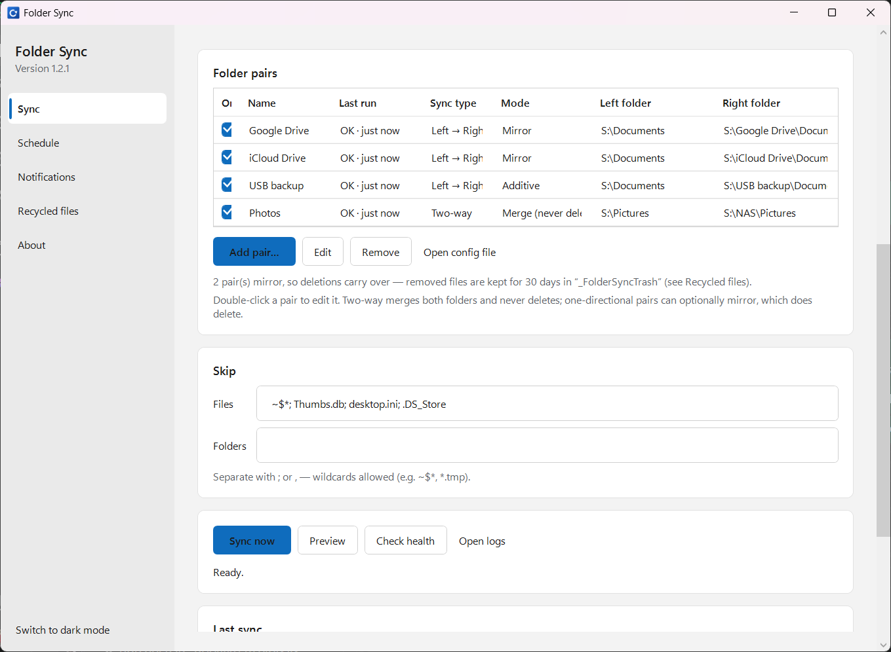
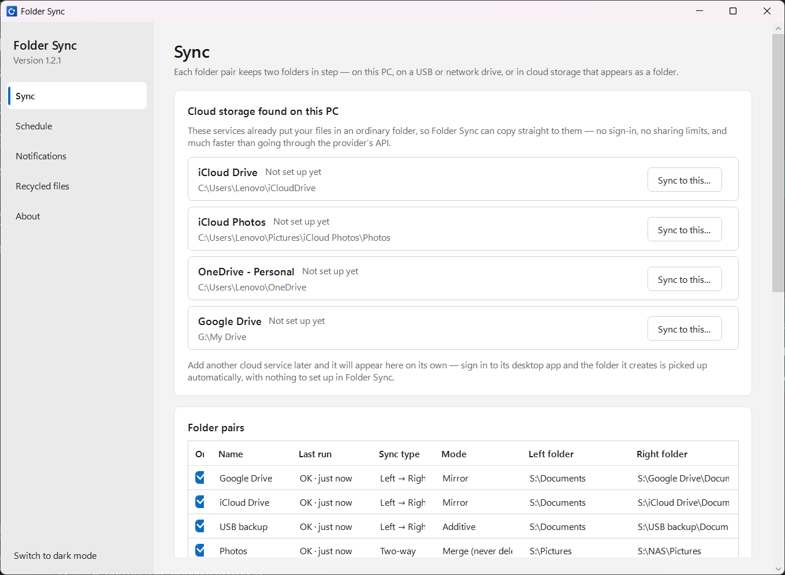
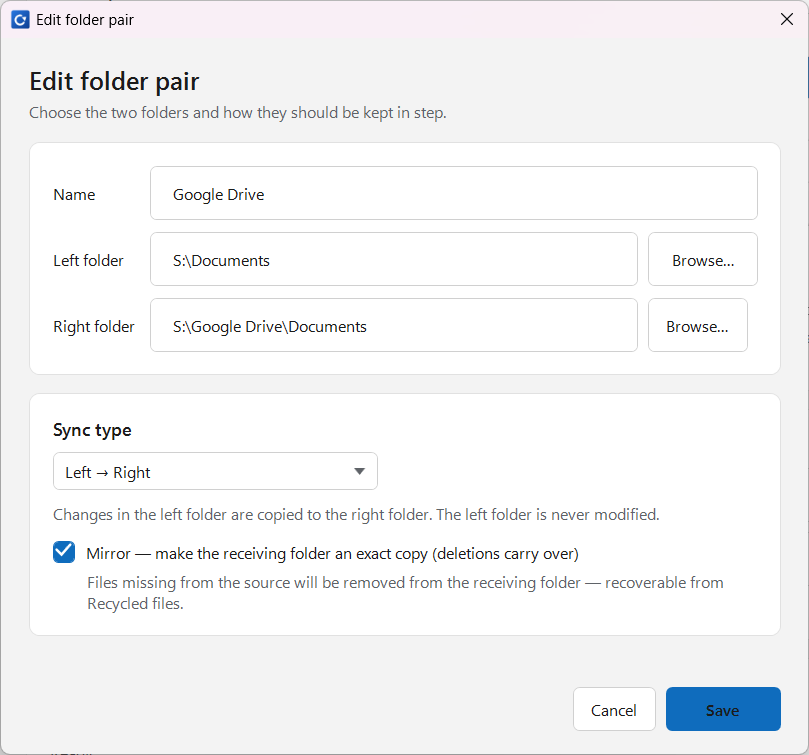
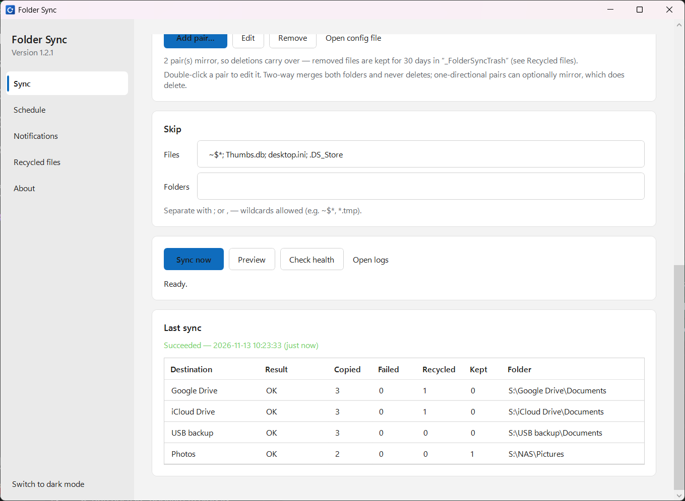
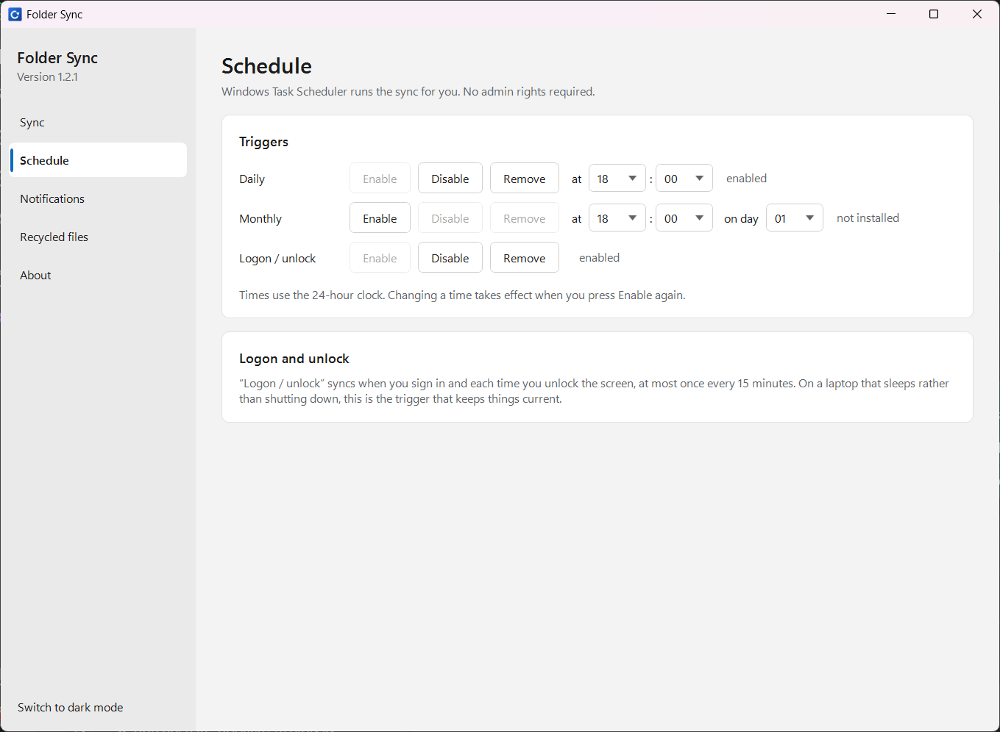
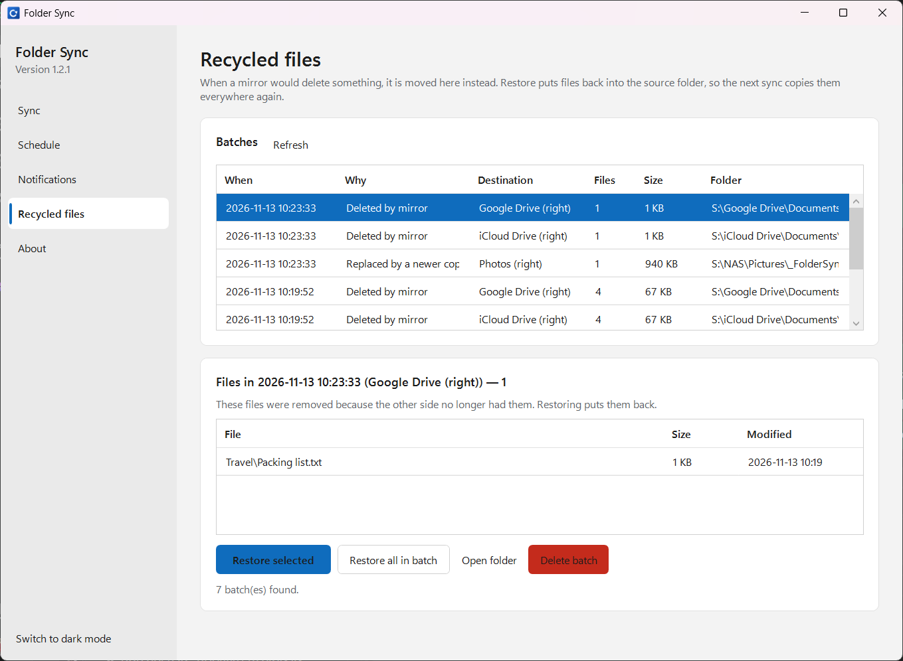
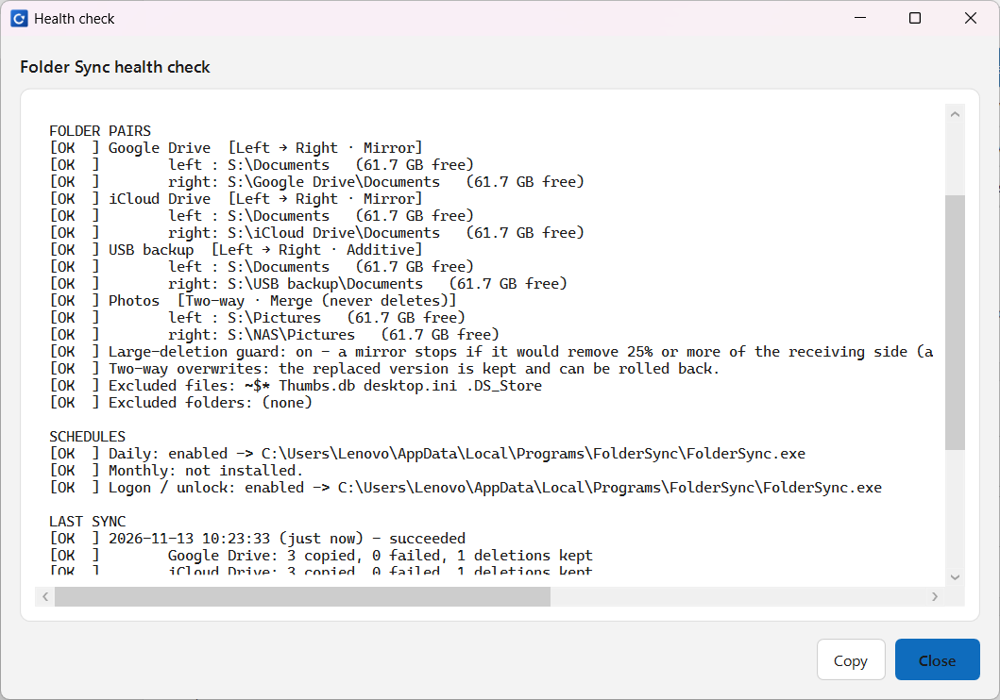
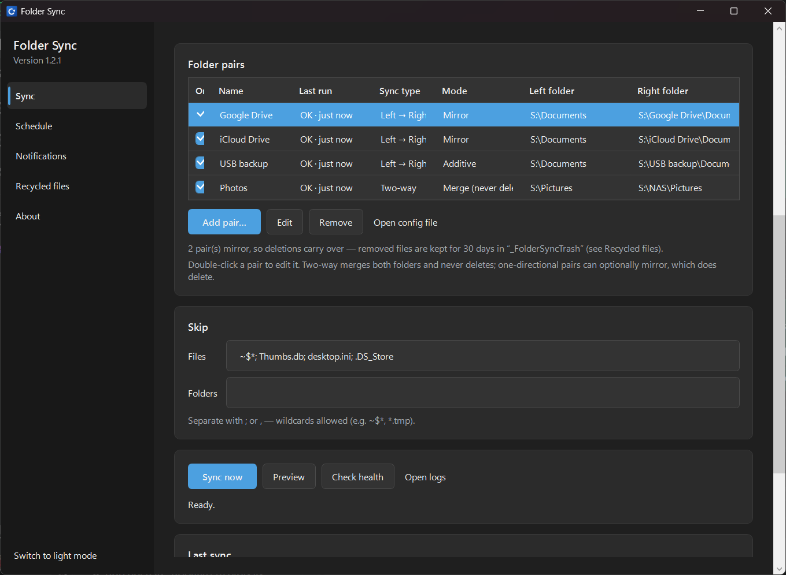

# Folder Sync

A small Windows app that mirrors one folder into **several destinations at once** — for example
your Documents folder into your **Google Drive**, **iCloud Drive** and an external backup drive,
all from a single click or on a schedule.

It works with cloud storage without any logins or API keys: OneDrive, iCloud Drive and Google
Drive for Desktop each keep a normal **local folder** on your PC that their own app syncs to the
cloud. Folder Sync just copies between those local folders, and each cloud client uploads from
there. That makes it fast and reliable, and it keeps working even if a provider changes its API.

Built with **.NET 10 / WPF**, using Windows' own **robocopy** for the file transfer and
**Task Scheduler** for automation.

```
Your folder → robocopy → Google Drive / iCloud / OneDrive folders + a backup drive → each cloud app uploads its own folder
```

## Screenshots

Folder pairs, cloud storage detection, scheduling, recycled files and the health check — all taken
on version 1.2.1 with sample folders on a demo drive, so you can see how it works before installing:

| Folder pairs | Cloud storage, found for you |
|---|---|
|  |  |

| Editing a pair | Last sync result |
|---|---|
|  |  |

| Schedule | Recycled files |
|---|---|
|  |  |

| Health check | Dark mode |
|---|---|
|  |  |

---

## Features

| | |
|---|---|
| **Multiple folder pairs** | Set up as many independent pairs as you like; switch each on or off individually. |
| **Finds your cloud storage** | Google Drive, OneDrive, iCloud, Dropbox and anything else that syncs into a folder are detected automatically and offered as a destination — no sign-in, no API keys, nothing to configure. |
| **Three sync types** | Left → Right, Right → Left, or Two-way (both folders merged, newer file wins). |
| **Mirror or additive** | A one-directional pair can mirror (an exact copy, deletions carry over) or stay additive — mirror to the cloud while a backup drive keeps everything. |
| **Deletion safety net** | For mirrored destinations, files that would be deleted are moved to a dated recycle folder instead, and can be restored from the app. Two-way pairs also keep the copy that a newer version replaced. |
| **Large-deletion guard** | If a mirror is about to remove an unexpectedly large share of the receiving side — the signature of a source folder that is wrong or not yet available — it stops untouched and says so. |
| **Per-pair status** | Each pair shows its last result and how long ago, so one that has been quietly failing is obvious at a glance. |
| **Preview (dry run)** | See exactly what *would* be copied or deleted before committing to it. |
| **Scheduling** | Daily, monthly, and **at sign-in / every screen unlock** — no admin rights needed. |
| **Email notifications** | Optional summary email after each scheduled sync, with the log attached. |
| **Restore deleted files** | Browse what a mirror moved aside and put files back into the source in a couple of clicks. |
| **Health check** | One button that diagnoses everything that can silently stop a sync. |
| **System tray** | Runs quietly in the tray with completion notifications. |
| **Skip lists** | Exclude file patterns and folders. |
| **Auto-update** | Notifies you when a new version is released and installs it in one click. |
| **Light and dark** | Follows your Windows theme, with a manual toggle. |

---

## Install

1. Download **`FolderSyncSetup-<version>.exe`** from the
   [**Releases**](https://github.com/BhoomilKalyani/FolderSync/releases) page.
2. Run it. On first launch, set your **Source** folder and add your **destinations**.

**Requirements:** Windows 10 or 11 (64-bit). Nothing else — the .NET runtime is bundled.

- Installs **per-user** to `%LOCALAPPDATA%\Programs\FolderSync`, so there is **no UAC prompt**.
- Adds a Start Menu entry, an optional desktop shortcut, and an **Add/Remove Programs** entry.
- Setup can turn on **sync at sign-in and unlock** for you.
- Your settings live in `%LOCALAPPDATA%\FolderSync\config.json`. **Updates keep them**;
  uninstalling leaves them in place too, so reinstalling picks up where you left off.

> **SmartScreen:** Setup is not code-signed, so Windows may show *"Windows protected your PC"* the
> first time. Choose **More info → Run anyway**. (Removing that warning requires a paid
> code-signing certificate.) Updates installed from inside the app are checked against the SHA-256
> published with the release before they run.

---

## Getting started

A fresh install starts empty — nothing is synced until you say so. The window has five pages in
the sidebar: **Sync**, **Schedule**, **Notifications**, **Recycled files** and **About**.

1. **Cloud storage found on this PC** lists the cloud services already installed. Click **Sync to
   this…** next to one and pick the folder you want backed up — that is the whole setup.
   Alternatively click **Add pair…** and choose both folders yourself.
2. Repeat for as many pairs as you need — one source can feed several folders, and different pairs
   can use different folders entirely.
3. Click **Preview** to see what would happen, then **Sync now** to do it.
4. Optionally open **Schedule** and enable the triggers you want. All enabled pairs run together.

> **About Google Drive:** use a folder under **`My Drive`**. The *"Other computers"* section is a
> read-only view of backups from other machines and does not upload changes.

Everything you edit saves immediately — there is no Save button.

---

## Folder pairs

Everything is organised as **folder pairs** — two folders plus a rule for keeping them in step. Add
as many as you like; they all run together when you sync. Double-click a pair to edit it.

### Sync type

| Type | What happens |
|---|---|
| **Left → Right** | Changes in the left folder are copied to the right. The left folder is never modified. |
| **Right → Left** | The mirror image of the above. |
| **Two-way** | Both folders receive whatever is newer on the other side, so each ends up holding everything. If the same file changed on both sides, the **newer one wins**. |

### Mirror

For a one-directional pair you can additionally tick **Mirror**, which makes the receiving folder an
exact copy — so files you delete from the source are removed there too (recoverable from
**Recycled files**). Leave it unticked for **Additive**, which only ever adds and updates. New pairs
start Additive, so nothing can be lost until you opt in.

> **Two-way never deletes, by design.** Robocopy has no memory of the previous run, so a file that
> vanished from one side is indistinguishable from a file just added to the other. Rather than guess,
> a two-way pair only ever copies: delete something on one side and the next sync restores it from
> the other. If you need deletions to propagate, use a one-directional pair with Mirror.

### The large-deletion guard

Mirroring is the one genuinely destructive thing here, and it goes wrong in a specific way: if the
sending folder is momentarily wrong — a drive letter that moved, a folder renamed, a cloud client
that hasn't finished starting and is briefly showing an empty tree — a mirror faithfully removes
everything at the other end.

So before a mirror deletes anything, Folder Sync counts what would go. If that is more than
`LargeDeletionPercent` (default **25%**) of the files on the receiving side *and* at least
`LargeDeletionMinimumFiles` (default **25**) of them, the pair is **stopped untouched** — nothing
deleted, nothing copied, nothing even moved to the recycle folder — and the reason is reported. Fix
the sending folder and sync again.

Both conditions have to be met, so clearing two files out of three doesn't block an ordinary sync of a
small folder. Set `"GuardLargeDeletions": false` to switch it off.

### Two-way conflicts

When the same file has changed on both sides of a two-way pair, the newer copy wins — and the copy it
replaces is **kept in the recycle folder** rather than being overwritten and lost, in its own
`-replaced` batch so it is never mistaken for a deletion. The log says how many files this happened to.

Note the honest limitation: without a record of the previous run, a genuine conflict cannot be told
apart from an ordinary update, so *every* replaced file is kept. Set
`"BackupOverwrittenFiles": false` if you would rather it didn't.

### Upgrading from an earlier version

An older config with a single **Source** and a list of **Destinations** is migrated automatically
into one `Left → Right` pair per destination, each keeping its own mirror setting — so behaviour is
unchanged. The old fields are then cleared.

### Recycled files

Because mirroring propagates deletions, anything a mirror is about to delete is **moved aside**
first rather than deleted — as is any file a two-way pair is about to overwrite with a newer copy
from the other side:

```
<destination>\_FolderSyncTrash\<yyyyMMdd-HHmmss>\<original relative path>
```

There are two kinds of batch, and the **Why** column says which:

| Folder name | Holds | What restoring does |
|---|---|---|
| `20260731-143022` | Files a mirror was about to **delete** | Brings them back — a recovery |
| `20260731-143022-replaced` | The version a file had before a newer copy **replaced** it | Rolls it back, discarding the newer content on the next sync |

That distinction matters: a replaced file still exists on both sides, so putting the old copy back is
undoing a merge rather than recovering something lost. The page spells this out for whichever batch
you select, and the restore prompt repeats it.

The **Recycled files** page lists these batches, shows what is inside, and restores files back into
the folder they came from — the next sync then carries that across the pair. The recycle folder is
never mirrored (otherwise it would be purged itself) and batches older than
`RecycleRetentionDays` (default **30**) are removed automatically. Set
`"RecycleDeletedFiles": false` to make deletions permanent instead.

---

## Scheduling

On the **Schedule** page each trigger has its own row with **Enable** / **Disable** / **Remove**,
and only the settings it needs. Buttons grey out to show the current state, and the pickers show the
time a trigger is actually registered for — changing one takes effect when you press **Enable** again.

| Trigger | Settings | When it runs |
|---|---|---|
| **Daily** | time | Every day at the chosen time. |
| **Monthly** | time + day | On the chosen day of each month. |
| **Logon / unlock** | none | When you sign in **and every time you unlock the screen**. |

Times are chosen from drop-downs rather than typed, so an impossible value can't be entered.

On a laptop that sleeps and locks rather than shutting down, **logon/unlock** is the trigger that
actually keeps things current. Because unlocking happens often, those runs are throttled to at most
one sync every `MinMinutesBetweenAutoSyncs` minutes (default **15**); skips are noted in
`logs\events.log`.

All three are ordinary **Task Scheduler** tasks running as your user with **no admin rights**.
They are registered from XML rather than `schtasks /SC …` because that is the only way to get:

- a **Session-Unlock** trigger (`/SC ONLOGON` cannot express it, and is refused without admin);
- `DisallowStartIfOnBatteries = false` — the command-line default silently **skips runs on
  battery**, which is fatal on a laptop;
- `StartWhenAvailable = true` — a run missed while the machine was asleep happens once it wakes.

---

## Email notifications

Optional: get a summary (with the run's log attached) after each **scheduled** sync. Manual runs
don't email — use **Send Test Email** to check your settings.

For Gmail you need a **16-character App Password**, not your normal password:

1. Turn on 2-Step Verification: <https://myaccount.google.com/signinoptions/twosv>
2. Create an App Password (app = *Mail*): <https://myaccount.google.com/apppasswords>
3. Paste the code into **App password** (spaces are fine) and click **Send Test Email**.

Each Google account has its own App Password and you can revoke it at any time. The password is
stored **DPAPI-encrypted** for your Windows user — never in plain text. Other providers work too:
change the SMTP host/port (587 = STARTTLS, 465 = SSL). Corporate Microsoft 365 tenants often block
SMTP sign-in, so a personal account is usually the more reliable sender.

---

## When something isn't working

Click **Check Health**. It reports `OK` / `WARN` / `FAIL` for the source, every destination
(including free space), each schedule **and whether its program file still exists**, how long ago
the last sync ran, email setup, and log writability.

Common causes:

| Symptom | Cause |
|---|---|
| A pair says **Skipped — drive not connected** | Exactly that: the USB or network drive isn't attached. Not an error, and no email is sent for it. |
| A mirror **stopped** without deleting anything | The large-deletion guard: the sending folder is probably wrong or not fully available. Check it and sync again. |
| Schedule shows enabled but never runs | It points at a program file that has moved. The app offers a one-click repair on startup. |
| Nothing syncs at startup | Windows only fires a *logon* trigger on a real sign-in; add the **unlock** trigger. |
| Email fails with `5.7.9` | You used your account password instead of an App Password. |

Logs live in `%LOCALAPPDATA%\FolderSync\logs` (**Open log folder** in the app): one
`sync-<timestamp>.log` per run, `preview-*.log` for dry runs, and `events.log` for schedule, update
and crash events. Sync and preview logs are pruned after 7 days; `events.log` is trimmed to its most
recent entries once it grows past half a megabyte.

If `config.json` is ever unreadable, Folder Sync keeps it as `config.bad-<timestamp>.json` beside it
and starts from defaults rather than overwriting your settings — `events.log` says what happened.

---

## Updates

The app checks GitHub for a newer release on startup, at most **once a day**. If one exists you get
a tray notification and an **Update to x.y.z** link; the dialog shows the release notes and an
**Update Now** button that downloads the installer, checks it against the SHA-256 published with
the release, runs it, and restarts the app. An installer that does not match is deleted and never
run; a release that publishes no checksum is offered as a link to the release page instead. You can also
check any time from the tray menu. Disable with `"CheckForUpdates": false`.

> The install path stays the same across versions on purpose. The scheduled tasks store an absolute
> path to `FolderSync.exe`, so a versioned install folder (as ClickOnce uses) would break them on
> every update. Setup also re-points any schedule left behind by an older install.

---

## Configuration reference

`%LOCALAPPDATA%\FolderSync\config.json` — the UI writes this, but you can edit it directly
(**Open config file**).

| Key | Default | Meaning |
|---|---|---|
| `Pairs` | `[]` | Folder pairs: `Name`, `Left`, `Right`, `Direction` (`0` = Left→Right, `1` = Right→Left, `2` = Two-way), `Mirror`, `Enabled`. |
| `Source`, `Targets`, `Mirror` | — | Legacy fields from the single-source model. Read once to migrate into `Pairs`, then cleared. |
| `RecycleDeletedFiles` | `true` | Move would-be-deleted files aside instead of deleting. |
| `RecycleRetentionDays` | `30` | How long to keep recycled batches. |
| `RecycleFolderName` | `_FolderSyncTrash` | Recycle folder name inside each destination. |
| `GuardLargeDeletions` | `true` | Stop a mirror that would delete an unexpectedly large share of the receiving side. |
| `LargeDeletionPercent` | `25` | Share of the receiving side that, once exceeded, is treated as suspicious. |
| `LargeDeletionMinimumFiles` | `25` | Never treat fewer files than this as suspicious, whatever the percentage. |
| `BackupOverwrittenFiles` | `true` | In a two-way pair, keep the copy that a newer version replaced. |
| `ExcludeFiles` | `~$*`, `Thumbs.db`, `desktop.ini`, `.DS_Store` | File patterns to skip (robocopy `/XF`). |
| `ExcludeFolders` | `[]` | Folders to skip (robocopy `/XD`). |
| `MinMinutesBetweenAutoSyncs` | `15` | Throttle for logon/unlock runs. |
| `CheckForUpdates` | `true` | Check GitHub for new releases at startup. |
| `UpdateRepo` | `BhoomilKalyani/FolderSync` | `owner/repo` that publishes releases. |
| `Email` | disabled | SMTP settings; password stored encrypted. |

### Command line

| Argument | Purpose |
|---|---|
| *(none)* | Open the window. |
| `--sync` | Sync silently and exit. Used by the scheduled tasks. |
| `--sync --auto` | Same, but honours the minimum-gap throttle (logon/unlock). |
| `--repair-schedules` | Re-point schedules at this copy of the app. Run by Setup. |
| `--register-logon` | Register the logon/unlock task. Run by Setup. |
| `--remove-schedules` | Remove all tasks. Run by the uninstaller. |

---

## Repo layout

```
*.cs, *.xaml                   The app, all in the repo root: WPF windows plus the engine
  SyncEngine.cs                Runs each pair: list-only pass, recycle, then robocopy
  RobocopyOutput.cs            Reads robocopy's output without relying on its (translated) words
  DeletionGuard.cs             Stops a mirror that would delete too much
  RecycleStore.cs              The recycle folder: batches, restore, pruning
  ScheduleManager.cs           Task Scheduler tasks, registered from XML
  CloudFolders.cs              Finds cloud storage that syncs into a local folder
  Updater.cs                   Release check, download and SHA-256 verification
  Emailer.cs                   Summary email (MailKit)
  SyncConfig.cs                config.json: load, migrate, save
tests/FolderSync.Tests/        xUnit tests
installer/FolderSync.iss       Inno Setup script
build-installer.ps1            Publishes self-contained, then compiles the installer
docs/screenshots/              The images above
.github/workflows/ci.yml       Build + test on every pull request and push to main
.github/workflows/release.yml  Publishes a release from a v* tag
.github/dependabot.yml         Weekly update PRs for the NuGet packages, the .NET SDK and the Actions
```

## Building from source

### Prerequisites

- [.NET 10 SDK](https://dotnet.microsoft.com/download) — `global.json` pins the SDK to the 10.x
  line so local builds match CI
- [Inno Setup 6](https://jrsoftware.org/isinfo.php), only for building the installer
  (`winget install JRSoftware.InnoSetup`)
- Windows 10 or 11 — the app is WPF, and it drives robocopy and Task Scheduler

### Running it

```powershell
dotnet build FolderSync.sln -c Release                              # compile everything
dotnet run --project FolderSync.csproj                              # run from source
.\build-installer.ps1                                               # dist\FolderSyncSetup-<version>.exe (+ .sha256)
```

Running from Visual Studio puts the exe in `bin\Debug\…`. Don't enable a schedule from there — it
would point at a path that disappears on the next rebuild. The app warns you if you try.

### Tests

```powershell
dotnet test tests\FolderSync.Tests\FolderSync.Tests.csproj          # 320 xUnit tests at 1.2.1
```

They cover the parts that can lose files or go wrong silently: reading robocopy's output (including
real output replayed with every word translated), the large-deletion guard, the recycle folder,
config loading and migration, and the update check with its checksum verification. Nothing in the
suite touches your real `config.json` or GitHub. The same suite runs in CI on every pull request
and push to `main`.

### Releasing a new version

1. Bump `<Version>` in `FolderSync.csproj`, then commit.
2. Tag it with a matching `v` prefix and push the tag, e.g. `git tag v1.1.1 && git push origin v1.1.1`

That's it — the **Release** workflow runs the tests, builds the installer and publishes the GitHub
release with the `.exe` and its `.sha256` attached, then reads the release back to confirm GitHub
reports the same checksum. To do it by hand instead, run `.\build-installer.ps1` and upload both
`dist\FolderSyncSetup-<version>.exe` and `dist\FolderSyncSetup-<version>.exe.sha256` yourself.

Existing installs compare the release **tag** against their own version, download the `Setup`
`.exe` asset, and run it only if it matches both GitHub's digest for the asset and the `.sha256`
file. Leave the `.sha256` out and the app will not install that release itself.

---

## How it works

```
        ┌──────────────┐
        │ Source folder │
        └──────┬────────┘
               │  robocopy /MIR (or /E), per destination
   ┌───────────┼───────────┬──────────────┐
   ▼           ▼           ▼              ▼
Google Drive  iCloud    OneDrive     Backup drive
 local folder  folder    folder        (D:\…)
   │           │           │
   └───────────┴───────────┘
      each cloud client uploads its own folder
```

- **robocopy** does the copying — it handles long paths, retries, multithreading and exact
  mirroring far better than hand-written copy code.
- Deletions in mirror mode are detected with a **list-only pass** first, so they can be moved to
  the recycle folder before the real mirror runs.
- robocopy's output is read without relying on its English words, which are translated on
  non-English Windows: a deletion is recognised as a path inside the receiving folder, a folder by
  its trailing `\`, and the totals by their fixed order.
- Task Scheduler provides automation; the app itself doesn't need to stay running.

### Why cloud storage is treated as a folder

Folder Sync deliberately does **not** talk to Google Drive, OneDrive or Dropbox over their web APIs.
Each of those services already has a desktop app that signs in and presents your files as an
ordinary Windows folder, which makes the API redundant and strictly worse:

- **Nothing to authorise.** No OAuth client, no token to expire, no consent screen.
- **Nothing that can be withdrawn.** An app cannot ship a Google API client for full Drive access
  without passing Google's paid verification review, so it would have to fall back on a shared
  client — and Google is retiring the widely-used shared one during 2026.
- **No rate limits.** API routes fail with `rateLimitExceeded` when the shared quota is busy.
- **Far quicker.** Every file over an API is an HTTPS round trip; a measured transfer of three tiny
  files took 51 seconds, against effectively nothing through the mounted folder.

Detection reads the register Windows keeps of apps that sync a cloud account into a folder
(`Explorer\SyncRootManager`), so a service does not need to be known to this code to be found —
install it and it appears. Google Drive is the one special case: it mounts a drive letter containing
`My Drive` rather than registering, so that is probed separately.

---

## Design notes / deliberate scope cuts

- **Cloud storage is a folder, not an API.** No OAuth, no tokens, no rate limits — see
  [Why cloud storage is treated as a folder](#why-cloud-storage-is-treated-as-a-folder). The cost:
  a service with no desktop app that syncs into a folder can't be a destination.
- **Two-way never deletes.** robocopy keeps no record of the previous run, so "deleted on one side"
  can't be told apart from "added on the other". Rather than guess, a two-way pair only ever copies.
  Deletions need a one-directional pair with Mirror.
- **One-way mirrors keep deleted files, not replaced ones.** A file removed from the source is
  moved to the recycle folder. A file that *changed* is simply replaced at the destination; only
  two-way pairs keep the version that was replaced.
- **One schedule for everything.** Every enabled pair runs together on each trigger. There are no
  per-pair schedules.
- **Some settings are config-file only.** The deletion-guard thresholds, recycle retention, the
  minimum gap between automatic syncs and the update check live in `config.json`
  (**Open config file**) — there is no Settings page yet.
- **Not code-signed.** That needs a paid certificate, so the first install shows a SmartScreen
  warning. In-app updates are checked against the release's SHA-256 instead.
- **Non-English Windows is covered by tests, not by a real install.** The parser ignores robocopy's
  words entirely, and the tests replay real robocopy output with every word replaced — but it has
  not been run on an actual non-English copy of Windows.
- **Windows only.** robocopy and Task Scheduler do the heavy lifting, and both are Windows tools.

## What I'd add next

In priority order:

1. **Previous versions on one-way mirrors.** The biggest real gap: a file overwritten with a bad
   copy is mirrored everywhere, and today only two-way pairs keep the version it replaced.
2. **An alert when a backup is overdue.** A pair that has not succeeded for several days should say
   so on its own, rather than waiting for someone to open the window.
3. **Review and approve when the guard stops a mirror.** Today the choices are to fix the folder or
   switch the guard off in `config.json`; showing what would be deleted and letting you approve
   that one run would be safer.
4. **A Settings page** for the options that are config-file only.
5. **A free-space check before copying,** so a full backup drive is reported up front instead of
   part-way through.

---

## Version history

### 1.2.1

- **Email library updated** to MailKit 5.0. Notification emails work as before; a recipient the mail
  server rejects is still reported as an error.
- **Release notes read cleanly in the update window.** They were shown with their formatting symbols
  (`##`, `**`, backticks).
- Build tooling kept current: .NET SDK 10.0.4xx and newer GitHub Actions.

### 1.2.0

- **Fixed: non-English Windows.** robocopy's labels are translated there, so the app found nothing a
  mirror would delete: nothing was moved to the recycle folder, the large-deletion guard never fired,
  and every report said no files were copied. Its output is now read without relying on any word
  robocopy prints.
- **Fixed: files with non-English names were deleted for good** instead of being recycled, because the
  listing could not represent them. It is now read in full Unicode, and with recycling on, a mirror
  never deletes anything it could not move aside first.
- **Fixed: two-way pairs overwrote a same-time, different-size file with no copy kept,** and never
  cleaned up their own backup batches.
- **One sync at a time.** A scheduled run and **Sync now** can no longer run over each other, and a
  second copy of the window points you at the one already running.
- **Updates are checked before they run.** The installer must match the SHA-256 published with the
  release, or it is deleted and not run.
- A drive root (`E:\`) works as a folder, a hand-edited `RecycleFolderName` can no longer point outside
  the pair, and a scheduled run that is stopped part-way keeps its log.
- Built on **.NET 10**, with Dependabot keeping the packages and the SDK current.

### 1.1.3

Correctness and robustness only — no new features.

- **A damaged `config.json` is no longer destroyed.** Loading an unreadable config used to replace it
  with defaults on the spot, silently wiping every folder pair, the email settings and the schedule
  preferences. It is now kept as `config.bad-<timestamp>.json` and the reason is written to
  `events.log`.
- **The health check no longer contradicts the engine.** A disconnected drive is reported as a
  warning that the pair will be skipped, not a failure, and a skipped pair is no longer listed as
  `OK`. It also reports previous versions kept, and whether the large-deletion guard is on.
- **A partly-downloaded update is never executed.** The installer's length is checked against what
  the release says before it is run; a truncated download is deleted and reported.
- **Fixed a latent hang.** Scheduled-task queries read their output and error streams one after the
  other, which deadlocks if a task ever produces enough output to fill a pipe. Both are now drained
  together.
- **`events.log` is capped.** Only the per-run logs were being pruned, so this one grew for the
  lifetime of the installation.
- **Check Health and the Recycled files list no longer freeze the window** — both do their scanning
  off the UI thread.
- Three relative-time formatters that had drifted into disagreeing, and two copies each of the size
  formatter and the scheduled-task parser, are now one of each.

### 1.1.2

- **Large-deletion guard.** A mirror that would remove an unexpectedly large share of the receiving
  side now stops untouched and explains why, instead of going ahead. This is the one genuinely
  destructive operation in the app, and the usual cause is a sending folder that is wrong or not
  fully available yet.
- **Two-way pairs keep the copy they replace.** Previously "newer wins" destroyed the older version
  with no way back. It is now kept in the recycle folder, and the log reports how many files were
  affected.
- **An unplugged drive is "skipped", not "failed".** A scheduled sync no longer reports an error —
  and no longer emails one — just because a USB or network backup drive isn't connected.
- **Per-pair status.** The pairs list shows each pair's last result and how long ago, so a pair that
  has been quietly failing for a week is visible immediately.
- **Fixed: summary emails reported the wrong thing.** Since 1.1.0 they showed a blank source and
  "Additive" regardless of the actual pairs, because they still read the pre-pairs `Source` and
  `Mirror` fields that the migration clears. They now report each pair's outcome and reason from the
  run itself, with totals for copied, failed, deletions kept and previous versions kept — and a pair
  that was skipped is tagged `SKIP` rather than `OK`, so an unplugged drive can never read as a
  completed backup.
- **Fixed: replaced versions were filed as deletions.** They now go to their own `-replaced` batch,
  and the Recycled files page explains what restoring each kind actually does.

### 1.1.1

- **Cloud storage is found for you.** The Sync page lists the cloud services already installed on
  the PC — Google Drive, OneDrive, iCloud, Dropbox and others — and sets one up as a destination in
  a single click. No sign-in, no API keys, nothing to configure.
- Detection reads the register Windows keeps of apps that sync a cloud account into a folder, so a
  service does not have to be known to Folder Sync to be listed: install it and it appears, named
  as Windows names it. Google Drive is handled separately, as it mounts a drive letter instead.
- Crashes are written to `events.log` and reported, rather than the window closing silently.

### 1.1.0

- **Folder pairs.** Replaced the single source with as many independent pairs as you like, each with
  its own sync type — Left → Right, Right → Left, or Two-way — and its own mirror setting.
- Rebuilt the interface in WPF, with light and dark themes.

### 1.0.0

- First release: mirror one folder to several destinations, scheduling via Task Scheduler
  (including at sign-in and screen unlock), preview, email notifications, deletion safety net,
  health check, exclusion lists, system tray, and one-click updates.

---

## Author

Developed by **Bhoomil Kalyani** — <bhoomil.kalyani999@gmail.com>

## Licence

Copyright © 2026 Bhoomil Kalyani. Released under the MIT Licence — see [LICENSE](LICENSE).
